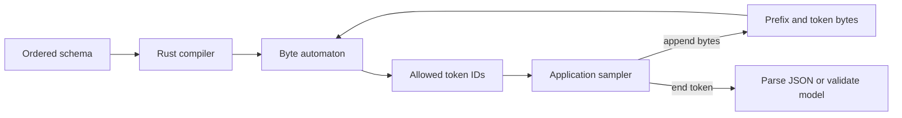

# Grammar-constrained decoding

[](https://github.com/asigdel29/grammar-constrained-decoding/actions/workflows/check.yml)
[](https://github.com/asigdel29/grammar-constrained-decoding/actions/workflows/benchmark.yml)
[](LICENSE)

Given a JSON Schema and a partial output, this library tells a decoder which token IDs can come next. A Rust compiler builds the grammar once. Rust and Python callers can reuse it across requests.

## Contents

- [Overview](#overview)
- [Architecture](#architecture)
- [Requirements and quickstart](#quickstart)
- [Native library and CLI](#native-library-and-cli)
- [Python interface](#interface)
- [Schema support](#schema-support)
- [CI and benchmarks](#ci-and-benchmarks)
- [Documentation and project structure](#documentation)
- [Graphify source map](#graphify-source-map)
- [Contributions](#contributions)
- [License](#license)

## Overview

For an integer schema, the prefix `-` can continue with a digit. It cannot end there. After `-2`, the decoder can choose another digit or the end token.

The library runs on the CPU in the host process. The caller supplies the vocabulary, applies the mask to the logits, and samples the next token. Pydantic users can validate the final JSON against a model.

## Architecture



| Component | Owns |
| --- | --- |
| Schema compiler | Supported keywords, local reference expansion, canonical property order. |
| Byte automaton | Prefix transitions, candidate eligibility, and the end-of-input check. |
| Decoder application | Token bytes, sampled IDs, prefix storage, and generation limits. |
| Python adapter | Schema export from Pydantic and final parsing or model validation. |

## Quickstart

Use stable Rust to build from source. The native CLI requires a CPU. Python integration requires Python 3.10 or later.

```sh
cargo build --release --locked
schema=$(mktemp)
printf '%s' '{"type":"integer"}' > "$schema"
printf '%s' '-21' | target/release/grammar-decode accepts "$schema"
```

The last command prints `true`. Use `printf` to send exactly the bytes in the output.

## Native library and CLI

Install the executable with `cargo install --path . --locked`. Use the schema from the quickstart to request a mask.

```sh
printf '%s' '{"prefix":[45],"vocabulary":{"0":[49],"1":[120]},"eos_id":2}' |
  target/release/grammar-decode mask "$schema"
```

The result is `[0]`. Token 0 contributes the digit `1`. Token 1 contributes `x`. The minus sign alone is incomplete.

For Rust integration, compile the schema with `Grammar::compile`. Create a cursor with `Grammar::prefix`. After each sample, keep the new cursor returned by `advance`.

## Interface

Install the Python binding from the repository root.

```sh
python3 -m venv .venv
. .venv/bin/activate
python -m pip install '.[pydantic]'
```

```python
from grammar_decode import compile_schema

grammar = compile_schema({"type": "string", "enum": ["yes", "no"]})
vocabulary = {0: b'"y', 1: b'es"', 2: b'"no"', 3: b'bad'}
assert grammar.allowed_ids(b"", vocabulary, eos_id=4) == {0, 2}
assert grammar.finish(b'"yes"') == "yes"
```

## Schema support

Supported types include strings, string enums, integers, numbers, booleans, null, homogeneous arrays, and objects with named fields. Objects use every declared field in schema order. The compiler handles acyclic references to root definitions. The [compiler contract](docs/design/compiler.md) gives examples and limits.

## CI and benchmarks

| Command | Coverage |
| --- | --- |
| `cargo test --locked` | Rust prefix, EOS, schema, and UTF-8 rules. |
| `make check` | Rust formatting, Rust tests, and installed Python conformance tests. Activate the environment with the Pydantic extra first. |
| `cargo bench --locked --bench masks` | Rust mask construction for a string with a partial UTF-8 character. |
| `make bench` | Python compile and mask costs across three synthetic workloads. |

The Check workflow builds and exercises wheels on Python 3.10, 3.12, and 3.13. The separate CPU benchmark workflow archives raw timings on pushes to main. See the [test log](docs/test-log.md) for a measured run.

## Documentation

| Document | Use it to |
| --- | --- |
| [Runbook](docs/runbook.md) | Install the tool, check exit status, and reproduce benchmark evidence. |
| [Compiler design](docs/design/compiler.md) | Decide whether an application schema can compile. |
| [Token mask design](docs/design/token-mask.md) | Integrate raw token bytes and handle completion. |
| [System design and UML](docs/system-design.md) | Trace ownership and request flow across language boundaries. |
| [Operating guide](docs/operations.md) | Integrate a decoder loop and diagnose rejected outputs. |
| [Test log](docs/test-log.md) | Inspect the tested revision, inputs, and observed results. |
| [Repository instructions](AGENTS.md) | Prepare and verify a change. |

| Path | Contents |
| --- | --- |
| `src/` | Rust compiler, automaton API, PyO3 binding, and native CLI. |
| `python/grammar_decode/` | Python interface, Pydantic integration, and benchmark driver. |
| `tests/` | Rust and Python conformance cases. |
| `benches/` | Native CPU benchmark. |
| `graphify-out/` | Source graph, interactive viewer, and source map report. |

## Graphify source map

Read the [report](graphify-out/GRAPH_REPORT.md), query the [graph data](graphify-out/graph.json), or open the [interactive map](graphify-out/graph.html) locally.

```sh
uv tool install graphifyy==0.9.76
make graph
graphify query "compile_schema"
```

The build reads tracked Python and Rust files, including tests. Stage new source files before regenerating the map.

## Contributions

Include a conformance case with each change to schema support or token eligibility. Update the contract and run the affected examples. Include the command and observed result in the pull request.

## License

Apache License 2.0. [License text](LICENSE)
