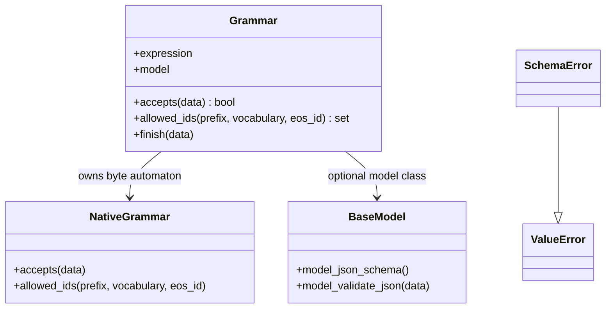
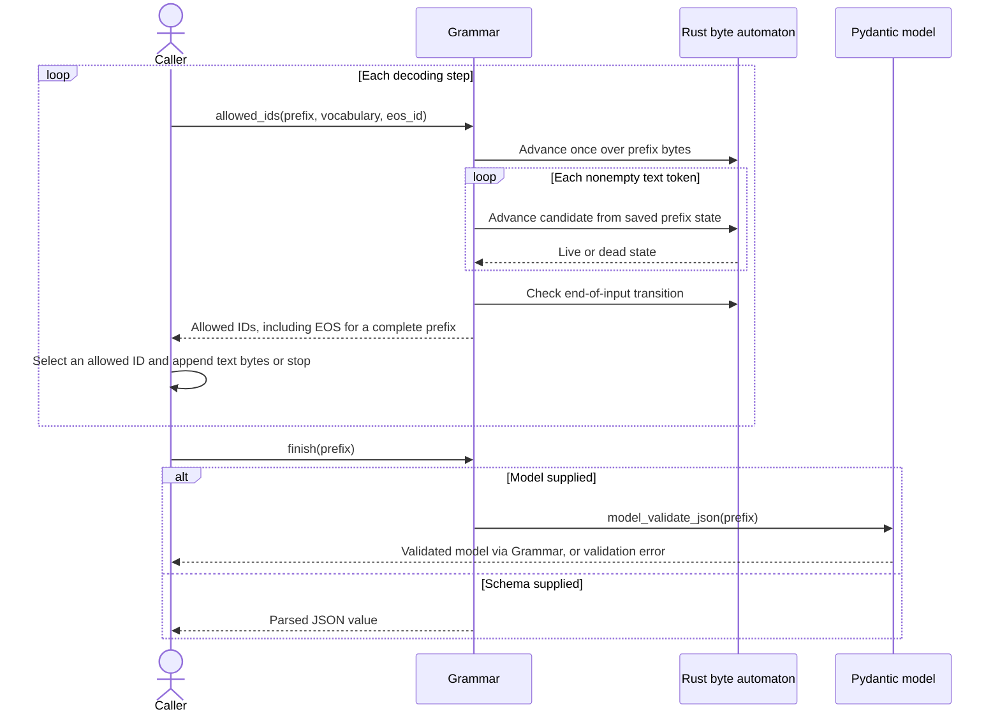

# System design

The package constrains a decoder to a subset of JSON. It runs in the caller's process. The caller owns the model, tokenizer, logits, and output buffer.

## Components

`compile_schema` copies the root schema and reads its local definitions. Rust translates each reachable node into a byte pattern. It compiles a dense DFA and returns it through a frozen Python adapter.
`compile_model` uses the model's exported schema. It retains the model class for final validation.
Each request can reuse the grammar and vocabulary. Each output stream needs its own prefix.

## Compile contract

| Schema construct | Output rule |
| --- | --- |
| Object | Emit all declared properties once, in declaration order. Emit compact separators. |
| Array | Emit zero or more values of the declared item type. |
| String | Accept JSON escapes and valid raw UTF-8 sequences. |
| String enum | Match the exact ASCII-escaped JSON encoding of a listed value. |
| Number or integer | Use the JSON number syntax for the requested type. |
| Boolean or null | Match the lowercase JSON literal. |
| Local reference | Expand a standalone reference to a named root definition. Reject cycles and missing targets. |

The object rule applies even when the schema allows extra fields or omits a field from `required`.
Annotations such as `default` do not insert values. Unsupported keywords on a compiled node raise `SchemaError`.

## Generation sequence

The end token has no text bytes. A complete numeric prefix can permit both the end token and another digit.
A partial match tests the grammar over bytes. A tokenizer with limited coverage can still reach a prefix with no available continuation.

## Cost and limits

A mask reads the prefix once. The automaton then reads each candidate until its last byte or the first dead transition.
A reusable Rust prefix cursor can skip the prefix scan on subsequent steps. The Python adapter retains the original stateless method contract.

The compiler limits expanded patterns to one MiB. The automaton builder limits its final table and construction workspace to 32 MiB each. Oversized schemas produce a compilation error. Repeated nested arrays can enlarge the expanded pattern. The compiler rejects traversal deeper than 128 levels.

The native CLI reads bytes and writes JSON. The Python adapter calls the same Rust compiler through PyO3. Pydantic runs application validators after the structural check.
