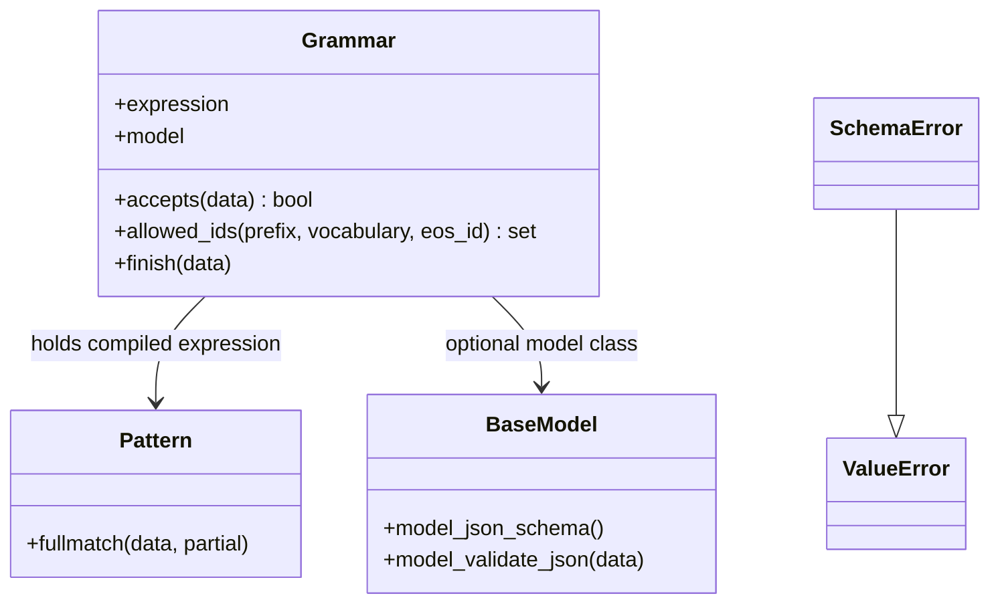
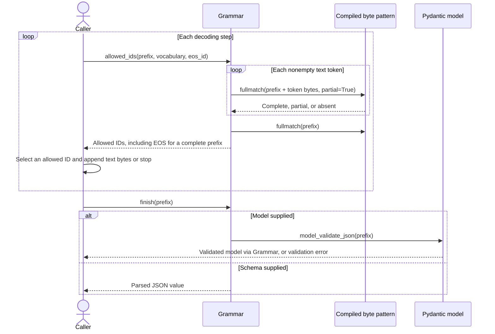

# System design

The package constrains a decoder to a subset of JSON. It runs in the caller's process. The caller owns the model, tokenizer, logits, and output buffer.

## Components

`compile_schema` copies the root schema and reads its local definitions. It translates each reachable node into a byte pattern. It returns a frozen `Grammar`.
`compile_model` uses the model's exported schema. It retains the model class for final validation.
Each request can reuse the grammar and vocabulary. Each output stream needs its own prefix.

## Compile contract

| Schema construct | Output rule |
| --- | --- |
| Object | Emit all declared properties once, in declaration order. Emit compact separators. |
| Array | Emit zero or more values of the declared item type. |
| String | Accept JSON escapes and valid raw UTF-8 sequences. |
| String enum | Match the exact ASCII-escaped JSON encoding of a listed value. |
| Number or integer | Use the JSON number syntax for the requested type. |
| Boolean or null | Match the lowercase JSON literal. |
| Local reference | Expand a standalone reference to a named root definition. Reject cycles and missing targets. |

The object rule applies even when the schema allows extra fields or omits a field from `required`.
Annotations such as `default` do not insert values. Unsupported keywords on a compiled node raise `SchemaError`.

## Generation sequence

The end token has no text bytes. A complete numeric prefix can permit both the end token and another digit.
A partial match tests the grammar over bytes. A tokenizer with limited coverage can still reach a prefix with no available continuation.

## Cost and limits

Mask construction scans the vocabulary for each output token. It builds a candidate byte string and matches from the start for each candidate.
Longer prefixes increase copy and match costs. The result set grows with the number of allowed IDs.
The caller applies this set to logits. The package provides no model server or mutable decoder state.

The benchmark measures complete mask construction at fixed checkpoints. Its warm compile path includes regex cache effects.
Use the operating guide to reproduce a run and interpret its records. [Operating guide](operations.md)
